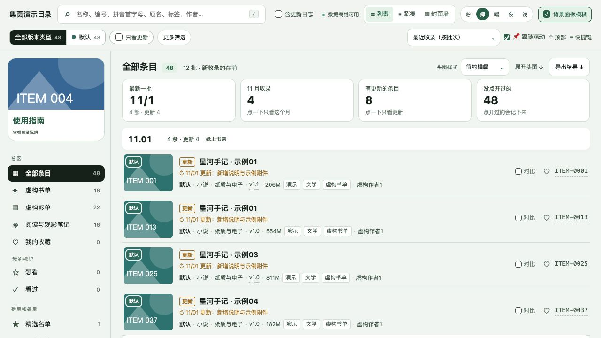
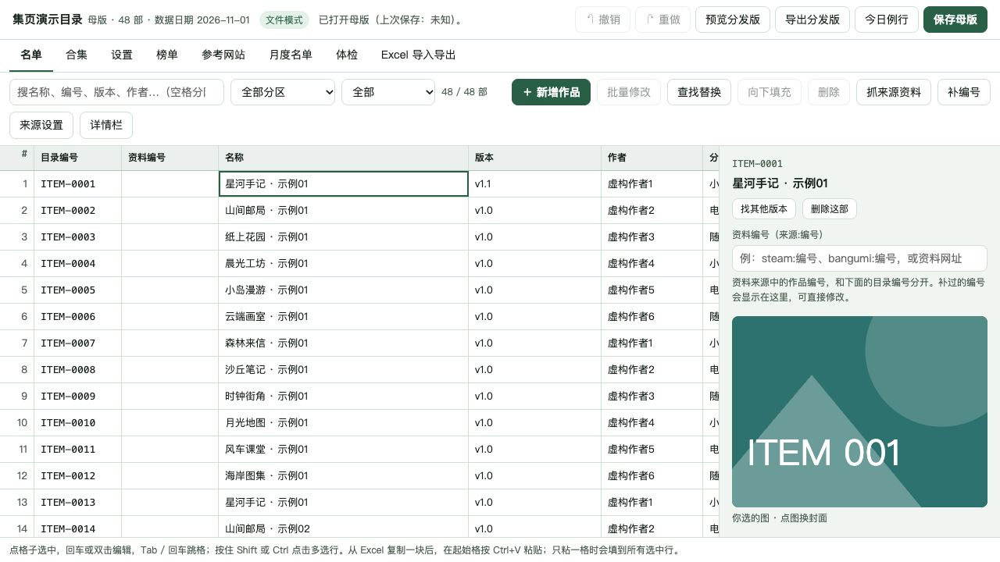
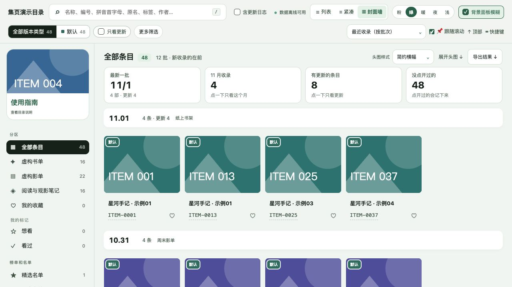
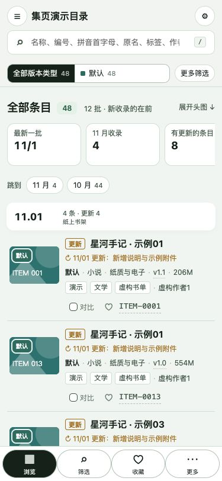

# 集页 Jiye

[简体中文](README.md) · [English](README.en.md)

**把书单、影单、课程、素材和收藏，整理成一个可编辑、可分享的离线目录。**

用母版维护内容，再导出一个只读 HTML 给别人看。不用部署网站，基本编辑和浏览无需账号或小助手；资料来源、参考网站和分享扫描均由使用者按需开启，默认离线。



## 三步开始

1. 获取完整包并解压，打开 **`空白母版.html`**。先体验功能可打开 `目录表-母版.html`，里面是48条虚构示例。
2. 添加自己的条目，或导入 XLSX。在「设置」调整字段名称、版本类型、主题和封面；不用的字段可以隐藏。
3. **保存母版 → 导出分发版**，把生成的只读 HTML 发给读者。母版保留自己的维护备注和配置。

发行附件见 [Releases](https://github.com/suifracti/jiye/releases)；没有已发布的完整包时，可按下方方法从源码构建。当前版本为 **v1.1.0**，界面以中文为主。

### 文件模式与小助手

| 使用方式 | 怎么打开 | 适合什么 |
|---|---|---|
| 文件模式 | 双击母版 HTML | 离线编辑、表格导入导出、预览和导出分发版。保存时按浏览器提示写回或下载新文件。 |
| 小助手模式 | 双击 `启动空白目录.bat` / `.command` | 直接写回、自动备份，以及主动开启的联网任务。运行期间保留小助手窗口。 |
| 只读目录 | 打开导出的分发 HTML | 搜索、筛选、收藏、标记、对比和浏览，无需小助手。 |

`启动目录表` 打开演示母版，`启动空白目录` 打开空白母版。完整 Windows 包带便携 Python；macOS 小助手需要本机 Python 3。

## 可以做什么

- **自由定义目录**：字段显示名称与显隐、版本类型名称和颜色、顶部提示、公告、最新版链接与旧目录提醒。
- **整理条目**：表格批量编辑、粘贴、撤销重做、标签整理、本地回填、待办、合集、榜单和月度名单。
- **表格往返**：XLSX 保留稳定 ID、合集和设置，导回时比较母版与表格的修改并处理冲突；CSV 用于单表交换。
- **方便读者查找**：编号、别名、简繁和拼音搜索，组合筛选、排序、收藏、个人标记、版本对比及已拿条目更新提醒。
- **调整展示**：列表、紧凑视图、封面墙、多种主题、手机底部导航、自选背景与模糊降级。
- **管理图片**：选图、粘贴、拖入后压缩，支持内嵌、外链和离线带图导出。没有第三方图床上传功能。

字段改名只影响显示，表格继续使用稳定字段键。个人收藏、标记和备注保存在当前浏览器，可通过工具菜单备份。

## 界面截图

以下均为 v1.1.0 的实际浏览器截图，使用虚构书单、影单和自制封面。

| 母版编辑 | 封面墙 |
|---|---|
|  |  |

<p align="center"></p>

## 可选联网功能

默认全部关闭，参考网站列表为空。在母版设置中启用需要的模块，再填写自己的来源或分享。

| 模块 | 用途 |
|---|---|
| 资料来源 | 通过可选 Steam、Bangumi 或自定义来源，按名称、编号补资料；人工内容优先，失败保留已有资料。 |
| 参考网站 | 添加自己的站点和搜索模板，预览候选图片，确认后保存。 |
| 夸克扫描 | 只读扫描自己的分享，辅助目录定位、大小统计、失效检查、取消续跑与换链接重扫。 |
| 今日例行 | 一键或分步运行已开启的任务，显示进度、部分结果及失败汇总。 |

联网需要本机小助手。接口可能变化；本版未完成真实分享和全部外站的联网验收。工具不提供资源，使用者自行维护有权使用的内容和链接。接口、元数据与图片的许可见[来源许可](docs/来源许可.md)。

## 从源码构建

需要 Python 3 和 Node.js；Node.js 用于离线检查。先克隆仓库，安装随源码提供的 Python 依赖：

```sh
git clone https://github.com/suifracti/jiye.git
cd jiye
python3 -m pip install --no-index tools/vendor/*.whl
python3 -I tools/make_demo.py
python3 -I tools/make_demo.py --blank --out demo/blank-data.json
python3 -I tools/check_release.py --build
```

输出位于 `dist/集页/`，ZIP 为 `dist/jiye-v1.1.0.zip`。检查会运行离线测试，核对演示数据、图片、HTML 和 ZIP；没有主动启用来源时不抓取外站资料。源码构建只有在本机准备了对应的便携 Python ZIP 时才会将它打入包；否则 Windows 小助手需要已安装的 Python。

只重建程序可运行 `python3 -I tools/build_package.py`。项目名称与版本集中在 `src/shared/product.py`，应用源码在 `src/`，生成工具在 `tools/`。

## 升级与进一步说明

升级时把新包解压到新目录，运行「升级母版」并选择自己的旧母版。程序保留旧文件，先备份新包的目标母版，再迁移数据。

- [使用说明](docs/使用说明.md)：编辑、图片、表格、导出和升级。
- [功能对照](docs/功能对照.md)：各功能的入口与处理方式。
- [检查记录](docs/验收记录.md)：已验证范围与限制；Windows、实体手机和真实分享尚未完成实机验收。
- [更新记录](CHANGELOG.md) · [反馈问题](https://github.com/suifracti/jiye/issues)

## 许可

项目代码使用 [MIT License](LICENSE)。第三方许可证位于 `LICENSES/`。演示数据为虚构内容，封面为自制几何图，不包含真实资源或第三方作品封面。
