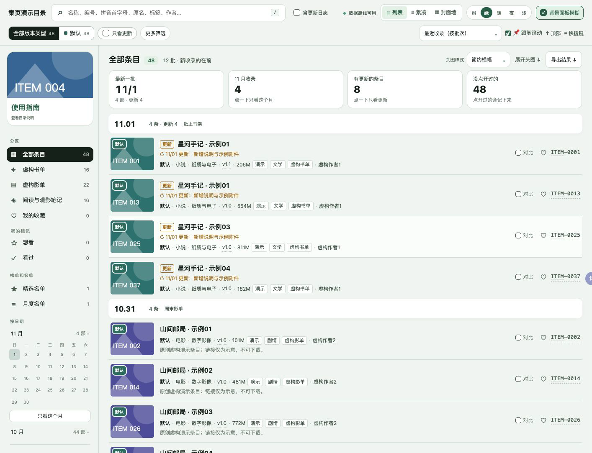
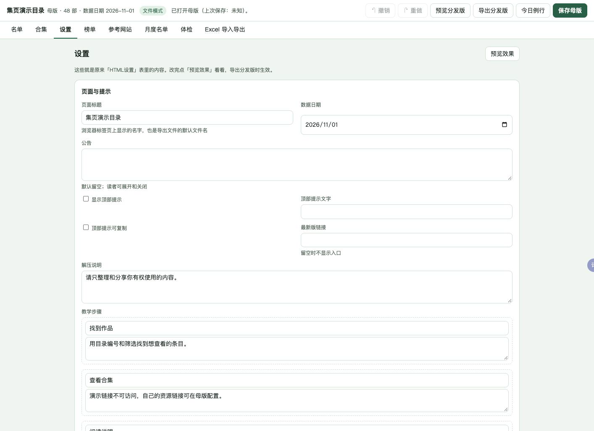

# 集页 Jiye

**把书单、影单、课程、素材或收藏做成可编辑、可分享的离线目录。**

母版用来维护内容，导出一份只读 HTML 给读者。无需部署网站，联网模块由你按需开启；默认不请求任何资料站、网盘或背景图源。项目不提供资源，用户应只整理和分享自己有权使用的内容与链接。

## 三步开始

1. 解压完整包，打开 `空白母版.html`（或先看演示母版）。填写自己的条目，也可以导入 XLSX。
2. 在「设置」改字段显示名称、版本类型徽章和外观。不用的字段隐藏；改显示名称不会改变表格的稳定字段键。
3. 保存母版，再点「导出分发版」，把生成的只读 HTML 发给读者。母版含维护备注和配置，自己保留。

需要直接写回空白母版和自动备份时，双击「启动空白目录」；查看演示可用「启动目录表」；纯文件模式仍可编辑、预览、导入导出和下载保存。Windows 包自带便携 Python；macOS 小助手使用本机 Python 3。

## 下载和演示

v1.1.0 完整包由维护者提供；[Release 页面](https://github.com/suifracti/jiye/releases)可查看发行记录。仓库保持私有，当前包可先存为草稿。

- `jiye-v1.1.0.zip`：制作工具、空白母版和原创演示。
- 演示是48条虚构书单、影单与笔记，自制几何封面；示意地址不可下载。

| 读者目录 | 手机目录 | 母版设置 |
|---|---|---|
|  |  |  |

## 自由配置，不用改代码

- 字段名称与显隐、版本类型名称和颜色、可复制顶部提示、公告及最新版链接。
- 搜索编号、别名和常用简繁；筛选、排序、收藏、标记、拿取清单、已拿条目更新与并排对比。
- 主题、封面墙、批次面板、自选背景、模糊降级、手机导航和键盘操作。
- 表格批量编辑、撤销重做、标签整理、本地回填、待办、榜单、月度名单和变化记录。
- 图片压缩、自选图片、来源记录和离线带图导出。不集成第三方图床上传。

## 可选联网模块

默认全部关闭。到设置中选择开启，并提供你有权访问和整理的来源。

- **资料来源**：可选公开资料适配器及自定义来源，按编号或名称补资料。
- **参考站点**：默认空列表；可添加自己的合法站点，找图后人工确认。
- **夸克扫描**：只读扫描你自己的分享，辅助定位、大小汇总、失效检查和换链。网络失败、扫描未完成与确认失效分开呈现；应用修改前先确认，可撤销。
- **今日例行**：只运行已开启的步骤，显示进度和各步结果；没有来源时引导配置。

接口可用、元数据使用和图片分发是不同事项；请遵守来源和网盘条款，不绕过访问限制。具体边界见[来源许可](docs/来源许可.md)。

## 表格与数据

XLSX 保留合集、设置、稳定 ID 和三方冲突选择；CSV 是单表交换，不包含完整目录关系。关闭字段只隐藏显示，既有数据仍可完整往返。详见[使用说明](docs/使用说明.md)、[功能对照](docs/功能对照.md)与[验收记录](docs/验收记录.md)。

## 从源码构建

项目名称与版本集中在 `src/shared/product.py`。安装 `tools/vendor/` 中的依赖后：

```sh
python3 -I tools/make_demo.py
python3 -I tools/make_demo.py --blank --out demo/blank-data.json
python3 -I tools/build_package.py
python3 -I tools/check_clean.py .
python3 -I tools/check_release.py --build
```

核心代码采用 MIT；第三方许可证单独放在 `LICENSES/`。示例不包含第三方封面或真实资源。

Jiye is an offline catalog template: edit a master file and share a single read-only HTML. Fields and optional sources are configurable. All examples are fictional; no resources are provided.
